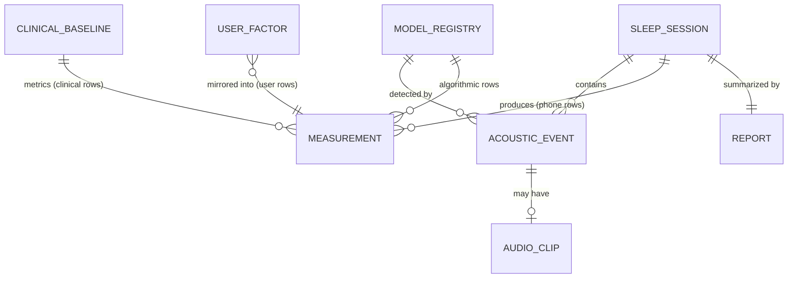

# Data Model — SleepAnalysis

Room/SQLite schema for the sleep intelligence platform. Design goals: **provenance on every measurement**, **immutable clinical data**, **long-lived analytics surviving heavy raw data**, and **no Tier-3 values ever stored** ([MEASUREMENT_RELIABILITY.md](MEASUREMENT_RELIABILITY.md)).

Related: [Architecture](ARCHITECTURE.md) (provenance enforcement, §6) · [MVP scope](MVP_SCOPE.md) · [Privacy & regulatory](PRIVACY_AND_REGULATORY.md)

---

## 1. Entity overview



`REPORT` (§3.7, schema v12) and `MODEL_REGISTRY` (§3.8, schema v12) are implemented: finalize writes each night's headline snapshot and registers the detector/score versions that produced it. Everything else is implemented.

Two write paths exist, both through `MeasurementRecorder` ([ARCHITECTURE.md](ARCHITECTURE.md) §6):

- **Session pipeline** (phone): AcousticEvent → Measurement → Report.
- **Entry/import paths**: user factors (report-side morning card; the standalone form was removed in the 2026-11-22 consolidation), wearable imports (Garmin Personal API + Health Connect, shipped) — landing as Measurement rows (or `sleep_stage` rows for HC stages) with their own source/method.

## 2. Conventions

- Timestamps: Unix epoch **milliseconds, UTC** (`Long`). Session-local times additionally stored as `offset_ms` from session start (timeline rendering across midnight/DST).
- Enums stored as `TEXT` (debuggability) with Room type converters.
- Booleans as `INTEGER`. Free-form structure as JSON `TEXT` with a `schema_version` alongside.
- All tables: `created_at` epoch ms where a write-time stamp is meaningful; **no** `updated_at` column exists anywhere (migration 15→16 removed the write-only `createdAt` columns from `acoustic_event` and `quiet_gap`).

## 3. Core entities

### 3.1 `clinical_baseline` — REMOVED (migration 15→16, 2026-11-22 consolidation)

The table, its DAO, its screen, and the two immutability triggers were dropped (task T7; see §4). Historical note: it stored one row per HUG study night (Phase 1 data: TST 5h34m–7h35m; efficiency 70–91%; arousal index 27.0–31.9/h; N3 7–15%; AHI 17.6).

| Column | Type | Notes |
|---|---|---|
| `id` | Long PK | |
| `study_date` | TEXT (ISO-8601 date) | e.g. `2026-01-12` |
| `lab` | TEXT | `"HUG"` |
| `study_type` | TEXT | `"PSG"` |
| `night_label` | TEXT? | `"Night 1"`, user-entered |
| `total_sleep_time_minutes` | Int? | TST |
| `sleep_efficiency_percent` | Double? | |
| `arousal_index_per_hour` | Double? | Clinical arousal index (context — never compared to phone-derived anything) |
| `n3_percent` | Double? | |
| `ahi_per_hour` | Double? | Clinical AHI (context — M15 forbids a phone-derived counterpart) |
| `source_document` | TEXT? | Path/note pointing at the PDF report the numbers came from |
| `notes` | TEXT? | e.g. "hypopnea-dominant; technical artifacts noted" |
| `entered_at` | Long | When the user typed it in |

Phase 1 data (from the four HUG nights): TST 5h34m–7h35m; efficiency 70–91%; arousal index 27.0–31.9/h; N3 7–15%; AHI 17.6 (Night 1, predominantly hypopneas).

### 3.2 `measurement` — the universal, provenance-stamped metric table

One row per metric value. This is the table all longitudinal analysis (Phase 4+) reads.

| Column | Type | Notes |
|---|---|---|
| `id` | Long PK | |
| `sessionId` | Long? FK → sleep_session, **ON DELETE SET NULL** | Null for user/period rows; survives session deletion |
| `sourceType` | TEXT enum | `CLINICAL` / `PHONE` / `USER` / `GARMIN` (implemented) · `WEARABLE` reserved for Health Connect on this table (the HC import writes no measurement rows — its provenance lives on `sleep_stage.source`, schema v14, §3.10) |
| `method` | TEXT enum | `CLINICAL_MEASURED` / `ALGORITHM_ESTIMATED` / `DEVICE_REPORTED` / `USER_REPORTED` |
| `measurementType` | TEXT enum | See §3.3 |
| `tier` | TEXT enum | `ESTABLISHED` / `EXPERIMENTAL` — validated against `ClaimPolicy` at write time; Tier 3 types are rejected |
| `valueNum` | REAL? | Numeric value |
| `valueText` | TEXT? | Non-numeric values |
| `unit` | TEXT enum | `SECONDS` / `MINUTES` / `PERCENT` / `COUNT` / `PER_HOUR` / `DBFS` / `INDEX_0_100` / `INDEX_0_10` / `MS` / `BPM` / `BREATHS_PER_MINUTE` |
| `isClinical` | Bool | True only for clinical-source rows (legacy rows; recorder logic keys on it — the SQL triggers that also keyed on it were dropped with `clinical_baseline` in 15→16) |
| `confidence` | REAL? | 0–1, nullable (user/clinical rows typically null) |
| `modelVersion` | TEXT? | Model identity stamped at write time — currently the `energy-heuristic-v3-peakgate` constant (older rows carry their era's detector string; `+dbg1` suffix when the debug enter-windows toggle was active). No `model_id`/registry-FK column exists; the temporal registry (§3.8) is written at finalize, not referenced from rows |
| `periodStart` / `periodEnd` | Long? | For period-scoped rows (e.g., per-hour, weekly) |
| `notes` | TEXT? | |
| `timestamp` | Long | When the value occurred (event/measurement time — not row-write time) |
| `createdAt` | Long | When the row was written |

**Indices (implemented):** `(measurementType, periodStart)`, `(sessionId)`, `(sourceType, method)`.

**Example rows (as written by the implemented code):**

| sessionId | source | method | type | tier | value | unit | model |
|---|---|---|---|---|---|---|---|
| 401 | PHONE | ALGORITHM_ESTIMATED | SNORE_TIME | ESTABLISHED | 812 | SECONDS | energy-heuristic-v3-peakgate |
| 401 | PHONE | ALGORITHM_ESTIMATED | SNORE_INTENSITY_PEAK | ESTABLISHED | -14.2 | DBFS | energy-heuristic-v3-peakgate |
| 401 | PHONE | ALGORITHM_ESTIMATED | NOISE_MEDIAN | ESTABLISHED | -31.5 | DBFS | energy-heuristic-v3-peakgate |
| 401 | GARMIN | DEVICE_REPORTED | VENDOR_HRV_RMSSD | ESTABLISHED | 48 | MS | null |
| null | USER | USER_REPORTED | ALCOHOL_UNITS | ESTABLISHED | 2 | COUNT | null |

(The retired `clinical_baseline` never mirrored into `measurement`; its AHI/TST values were written directly to that table, removed in 15→16.)

### 3.3 `measurement_type` registry (extensible enum, enforced in `ClaimPolicy`)

**Phase 1 (Tier 1, phone):** `TIME_IN_BED`, `SNORE_EVENT_COUNT`, `SNORE_TIME`, `SNORE_SHARE_OF_NIGHT`, `SNORE_INTENSITY_PEAK`, `SNORE_INTENSITY_MEAN`, `SNORE_SCORE`, `ACOUSTIC_EVENT_COUNT` (per type), `NOISE_MEDIAN`, `NOISE_P95`.

**Phase 2+:** `SLEEP_DURATION_ESTIMATE`, `WAKE_DURATION_ESTIMATE`, `MOVEMENT_INDEX`, `BREATHING_IRREGULARITY_INDICATOR` (*Tier 2 — experimental*), `RESPIRATORY_PATTERN_INDICATOR` (*Tier 2 — experimental*).

**Clinical:** `TST`, `SLEEP_EFFICIENCY`, `AROUSAL_INDEX`, `N3_PERCENT`, `AHI`, plus free-text hypnogram summary via `notes`/`value_text`.

**Wearable (Phase 3, Garmin slice implemented — all `ESTABLISHED` device-reported pass-through, tiers per [MEASUREMENT_RELIABILITY.md](MEASUREMENT_RELIABILITY.md) §8):** `VENDOR_SLEEP_DURATION`, `VENDOR_SLEEP_SCORE`, `VENDOR_HRV_RMSSD`, `VENDOR_BODY_BATTERY`, `VENDOR_RESTING_HEART_RATE`, stage totals as four per-stage types (`VENDOR_DEEP_SLEEP` / `VENDOR_LIGHT_SLEEP` / `VENDOR_REM_SLEEP` / `VENDOR_AWAKE_SLEEP`; there is no `VENDOR_SLEEP_STAGES` row type), overnight heart rate (`VENDOR_AVG_HEART_RATE_SLEEP`), respiration (`VENDOR_RESPIRATION_AVG_SLEEP`), stress composites (`VENDOR_SLEEP_STRESS_AVG`, `VENDOR_STRESS_DAILY_AVG`), SpO₂ levels (`VENDOR_SPO2_AVG_SLEEP`, `VENDOR_SPO2_LOWEST_SLEEP`), `VENDOR_SLEEP_AWAKENINGS`, `VENDOR_NAP_TIME`, `VENDOR_SLEEP_NEED`, and the four sleep-score factor sub-scores (`VENDOR_SLEEP_FACTOR_{DURATION,QUALITY,STRESS,TIMING}`). The Health Connect slice writes stage-timeline rows instead (§3.10), not measurement rows — `WEARABLE` stays reserved on this table.

**User:** factor keys (§3.6).

### 3.4 `sleep_session`

| Column | Type | Notes |
|---|---|---|
| `id` | Long PK | |
| `startedAt` / `endedAt` | Long, `endedAt` nullable | Null endedAt ⇒ in progress / interrupted |
| `status` | TEXT enum | `COMPLETED` / `INTERRUPTED` / `RECOVERED` |
| `timeZone` | TEXT | IANA id at session start |
| `captureStats` | TEXT (JSON, v2) | See §5.1 |
| `morningNotes` | TEXT (schema v6) | Short user note added after the night. User-entered context, never a measurement; **included in exports** |
| `resumedAfterInterruption` | Bool (schema v7, DEFAULT 0) | Set only by the explicit **Resume** action on the interrupted-night banner: the user chose to continue a session whose capture was **not** continuous (a START_STICKY restart does *not* set it — capture never auto-resumes; `StartIntentPolicy` refuses the background restart). The morning report leads its integrity notes with it. `RECOVERED` status covers the opposite outcome (death with no resume) |

(Write-only reproducibility columns — `deviceModel`, `osVersion`, `appVersion`, `audioBytesTotal` — were dropped in migration 15→16.)

### 3.5 `acoustic_event` and `audio_clip`

`acoustic_event` — raw detections (session-scoped, cascade-deleted):

| Column | Type | Notes |
|---|---|---|
| `id` | Long PK | |
| `sessionId` | Long FK, **ON DELETE CASCADE** | |
| `type` | TEXT enum | Phase 1: `SNORE` / `COUGH` / `SPEECH` / `LOUD_BREATHING` / `OTHER_NOISE` / `UNKNOWN`. Phase 2 adds experimental types (`GASP_LIKE`, `BREATHING_PAUSE_CANDIDATE`) — Tier 2 only |
| `startMs`, `endMs` | Long | Epoch |
| `offsetMs`, `durationMs` | Long | Session-local, derived-but-stored for queries |
| `peakDbfs`, `meanDbfs` | REAL | Relative intensity only ([MEASUREMENT_RELIABILITY.md](MEASUREMENT_RELIABILITY.md) M2) |
| `intensityTier` | TEXT enum | `QUIET` / `LIGHT` / `LOUD` / `EPIC` |
| `confidence` | REAL | Detector confidence at peak |
| `modelVersion` | TEXT | Detector identity (e.g. `energy-heuristic-v3-peakgate`; older rows carry their era's string); no model_id/registry FK column (§3.8) |
| `clipId` | Long? FK → audio_clip | |
| `userLabel` | TEXT? | User-corrected class from clip playback: `SNORE` / `COUGH` / `SPEECH` / `MOVEMENT` / `OTHER_NOT_SNORE` / `SILENCE` (nothing real on the clip) — the personal labeled dataset Phase 2 model improvement trains against. **Since `snore-score-v3` (2026-11-08) labels also re-weigh the night's aggregates**: a non-SNORE label excludes the event from every snore aggregate, `SNORE` includes it, no label keeps the detector's class (`SnoreMath.eventsCountingAsSnore`) — the session's snore-aggregate PHONE rows are recomputed and rewritten on label save, flagged `label_corrected=true` in notes (§3.2). The stored `type` column is never changed. (The separate `labeledAt` timestamp column was dropped in 15→16) |
| `featuresJson` | TEXT? | The detection model's decision inputs as JSON (schema v5; for `energy-heuristic-v1-spectral`: `enter_windows`, `exit_windows`, `open_windows`, `close_windows`, `snr_peak_db`, `snr_mean_db`, `low_band_ratio_peak`, `low_band_ratio_mean`, `noise_floor_dbfs`, `spectral_flatness_mean`, `harmonic_ratio_mean` — the v0 rows predate `exit/open/close_windows` (added schema v7 era, 2026-11-02), and rows recorded before 2026-11-05 lack the two spectral means (absent key = null on parse)). Debug visibility of detector decisions — never a measurement, never rendered as clinical. (Its write-only `createdAt` was dropped in 15→16) |

`audio_clip`:

| Column | Type | Notes |
|---|---|---|
| `id` | Long PK | |
| `sessionId` | Long FK, CASCADE | Denormalized for fast retention sweeps |
| `eventId` | Long? FK, unique | 1:1 with an event when set |
| `filePath` | TEXT | Relative to `filesDir/clips/` |
| `durationMs`, `sizeBytes`, `sampleRate` | Long/Int | sampleRate = 16000 |
| `appliedGain` | REAL | Total gain applied to the stored samples (schema v11): mic gain × block peak-limit scale — below the mic gain on loud clips, which are written raw + limited so their peak lands at ≈ −1 dBFS instead of clipping to 0 dBFS. Pre-v11 rows keep the fixed 2.5 in-place int16 mic gain (the v11 DEFAULT is truthful history) |
| `filePeakDbfs` | REAL? | Peak of the stored samples in dBFS (schema v11, ≈ −1.0 on limited clips); NULL for pre-v11 rows, whose peaks were never recorded |
| `createdAt` | Long | |

**Index:** `(sessionId, startMs)` on events; `createdAt` on clips (retention).

### 3.6 `user_factor` — lifestyle logging (implemented in Phase 3, lightweight UI)

| Column | Type | Notes |
|---|---|---|
| `id` | Long PK | |
| `date` | TEXT (ISO, local) | The day the factor applies to |
| `factorKey` | TEXT enum | `ALCOHOL` (units in valueNum, 1.0 = yes-unspecified), `LATE_MEAL`, `CAFFEINE_AFTER_14`, `EXERCISE`, `MEDICATION_OR_DEVICE` (1.0 = yes), `STRESS` (1–5), `NOTES` (valueText), plus the morning-rating/day keys (`MORNING_RATING`, `SICK`, `SLEPT_ON_BACK`) |
| `valueNum` / `valueText` | REAL? / TEXT? | |

(The write-only `recordedAt` column was dropped in migration 15→16.)

Only set/affirmative factors are stored — absence means "not logged that day". Saving a date replaces that date's rows. These are **user-entered context, not measurements**: no tier, no confidence, no Measurement rows; the report renders them under "Daily factors (self-logged)". Mirroring into `measurement` (`source_type = USER`, `method = USER_REPORTED`) is deferred to Phase 4's analysis engine, which will read them with explicit user-reported framing. Wiped by delete-all.

### 3.7 `report` — morning report snapshot (schema v12, implemented)

The full report stays a **live in-memory computation** (`ReportAssembler` → `MorningReport`); this table stores one compact HEADLINE snapshot per session at finalize — the numbers the night's own measurements carry, plus the model provenance later analysis needs to gate comparisons (schema v12, docs/INSIGHTS.md). One row per session (unique index, regeneration upserts); the session's deletion removes it (FK CASCADE) — reports remain regenerable while source data exists, never a second source of truth (§6). Delete-all purges the table.

| Column | Type | Notes |
|---|---|---|
| `id` | Long PK | |
| `sessionId` | Long FK, CASCADE | |
| `generatedAt` | Long | |
| `appVersion` | TEXT | App version at finalize |
| `detectorVersion` | TEXT? | First snore event's model version (null: no snoring that night) |
| `scoreVersion` | TEXT? | SNORE_SCORE formula version ([SnoreScore.FORMULA_VERSION]) |
| `payload` | TEXT (JSON) | Compact headline JSON (`schema_version` INSIDE the JSON — `domain/report/ReportSnapshot.kt`), shape per §5.2 |

Written only at finalize, inside the same transaction as the measurements and the NIGHT_VALIDITY row; a user-label recompute (`labelEvent`) refreshes the snapshot in ITS transaction so the payload keeps mirroring the rewritten aggregates — one pure builder (`reportSnapshotHeadline`) serves both paths, so neither can drift from the stored rows. Never contains values ClaimPolicy would refuse to render.

### 3.8 `model_registry` — temporal model-version registry (schema v12, implemented)

One row per (kind, version) validity range: which DETECTOR and SCORE versions produced which nights — the comparability record the personal-baseline eligibility gates read (docs/INSIGHTS.md §Eligibility). Written at finalize: when the current detector/score version differs from the latest registry row of its kind, a new row opens (`validFromUtc` = now) and the previous open row closes (`validToUtc` = now); `validToUtc` null = still current, exactly one open row per kind.

| Column | Type | Notes |
|---|---|---|
| `id` | Long PK | |
| `kind` | TEXT | `DETECTOR` or `SCORE` |
| `version` | TEXT | e.g. `energy-heuristic-v2-burst`, `snore-score-v3` |
| `valid_from_utc` | Long | |
| `valid_to_utc` | Long? | Null = current |

Read paths: current version per kind, full history, and range queries (versions valid at a given instant). A night's detector version is resolved once — the label-aware first snore event's version, else (zero-snore night) the detector current at finalize — and that single resolved value lands on the snapshot (§3.7), the registry row and the insight eligibility gate (docs/INSIGHTS.md §Eligibility). The Phase-2 asset-level registry (bundled TFLite/ONNX file identity, runtime, input spec, thresholds) remains deferred until a second binary model exists — the version-provenance need it serves is covered by this table today.

### 3.9 `raw_payload` — vendor JSON storage (schema v2)

One row per `(source, endpoint, date)` (unique index), storing external API responses verbatim so field mappings can be corrected without data loss. Written by the Garmin import ([GARMIN_INTEGRATION.md](GARMIN_INTEGRATION.md) §5); re-import upserts. Retention: rows follow **session retention** (default 90 days) — `RetentionWorker` deletes `fetchedAt` older than the cutoff; the mapped vendor metrics themselves survive in `measurement`; delete-all purges the rest.

### 3.11 `quiet_gap` — stored quiet stretches (schema v10)

One row per event-free span ≥10 min inside a session's capture window: `(sessionId FK CASCADE,
startMs, endMs, durationMs, kind, meanDbfs)`. Computed at finalize from the night's events and
the capture's level buckets — `kind` is `QUIET` (level buckets cover ≥50% of the span; real
quiet sleep, with the overlap-weighted mean window dBFS as evidence), `UNCAPTURED` (no bucket
evidence: process death), or NULL (partial evidence / pre-v3 capture stats). Replace-per-session
on re-finalize; session deletion removes them (FK CASCADE); delete-all purges the table. The
report reads stored rows and falls back to the identical report-time computation for legacy
nights ([NIGHT_REPORT.md](NIGHT_REPORT.md) §1).

### 3.10 `sleep_stage` — vendor stage timeline (schema v9, per-source since v14)

One row per contiguous stage span of a **linked** session: `(sessionId FK CASCADE, startMs, endMs, stage, source)` with a `(sessionId, startMs)` index. Populated by the Garmin import only when the dailySleep payload carries a `sleepLevels` timeline AND a time-overlapping session was identified (§5, §6), and by the Health Connect import from the wearable stage timeline over on-device IPC (user-triggered, docs/PRIVACY_AND_REGULATORY.md §3); each re-import replaces atomically. Device-reported context only (M13) — never compared to PSG stages; the night report uses it to say which stage the longest snore bout fell in. Stage labels are the vendor's own, canonicalized to DEEP/LIGHT/REM/AWAKE where known, unknown labels kept verbatim (HC: AWAKE_IN_BED folds to AWAKE; SLEEPING/OUT_OF_BED/UNKNOWN spans are skipped but accounted per type in the raw_payload summary row). `source` (schema v14) is provenance: `GARMIN` = stage spans derived from the Personal API night payload (estimate), `WEARABLE` = Health Connect stage timeline — both timelines can coexist on one session, so deletes/replaces are per-source. Session deletion removes the timeline (FK CASCADE); delete-all purges the table (all sources).

### 3.12 `sleep_experiment` — REMOVED (migration 15→16, 2026-11-22 consolidation)

The table and the machinery around it (`ExperimentTracker`, `Playbook`, `EscalationRule`) were dropped in task T7; the N-of-1 experiments line is shelved (NEXT_STEPS). Historical note: it stored one row per N-of-1 experiment with a single-ACTIVE-row invariant enforced in tracker logic, verdict math in the pure `ExperimentMath`.

## 4. Clinical immutability — RETIRED (2026-11-22 consolidation)

The `clinical_baseline` table, `BaselineRepository`, the baseline UI, and the two immutability triggers (`trg_clinical_baseline_no_update` / `trg_clinical_baseline_no_delete`) were dropped in migration 15→16 — there are no clinical rows left to guard, and INV-03 retires with them. Measurement-level claim discipline lives entirely in code (`MeasurementRecorder`/`ClaimPolicy`), never SQL. `purgeEverythingIncludingClinical()` (the delete-all maintenance path) now wipes the ten surviving tables in one transaction.

## 5. JSON payloads

### 5.1 `capture_stats` (session) — implemented shape

Written at session finalize and at every heartbeat (progress persistence for START_STICKY carry) by `SessionRepository` from `AudioEngine.NightStats`. For sessions finalized as RECOVERED the final write is skipped — heartbeat-saved stats (if any) are kept as-is, so the row carries the last live counters plus `saved_at_ms`; only when the engine died before any heartbeat does the row fall back to `{"schema_version":1}`. Parsed tolerantly by `domain/report/CaptureStats` — missing/malformed fields become null — and rendered in the report's "Session health" section, where `ReportAssembler` derives plain-language health warnings (suspected capture gaps when **accounted** windows — classified plus thermally skipped — fall > 10 % below the 0.5 s-hop expectation, thermal throttling).

Snore share and score (measurements and report) use **captured analysis time** — `(windows_processed + windows_skipped) × 0.5 s`, cumulative across engine restarts — as their denominator, not tap-to-end time in bed: the latter counts the start delay, process-death gaps and pre-capture wall time as "night". Since schema **v5** the counters are disjoint: `windows_processed` counts only windows the detector classified, and a thermally skipped hop increments `windows_skipped` exactly once (pre-v5 writers counted a skipped hop in both, inflating the denominator ~1.5× under sustained throttling) — the sum counts every captured hop once. A RECOVERED session with no events records no time-in-bed, share or score at all. Since the zero-window gate (P2-7), a night with **no capture stats or zero processed windows** (e.g. a stop during the start delay) records no snore-time, share or score rows at all — zeros would be fabricated data.

```json
{
  "schema_version": 6,
  "windows_processed": 56340,
  "windows_skipped": 12,
  "ambient_dbfs_median": -31.5,
  "ambient_dbfs_p95": -22.1,
  "clip_count": 47,
  "thermal_throttle_events": 1,
  "level_gate_skipped": 231,
  "spectral_skipped": 5120,
  "saved_at_ms": 1793564621686,
  "capture_started_at": 1793747285656,
  "thermal_skipped_hops": [[1793564621686, 1793564624686, 3], [1793564629686, 1793564630686, 1]],
  "client_silenced_spans": [[1793749800000, 1793750400000]],
  "ambient_level_buckets": [[1793747400000, 1793747700000, -84.5, 299500, 2.4137]]
}
```

`saved_at_ms` stamps heartbeat writes (a RECOVERED finalize bounds the night by the last heartbeat) and `capture_started_at` records when audio capture actually began after the start delay — the health-warning gap check compares accounted windows (classified + thermally skipped) against that capture window, not tap-to-stop wall time. v2 adds `level_gate_skipped` (events the relative level gate rejected — kept for diagnostics, the events are still stored without clips) and `thermal_skipped_hops`: merged spans of `[start_epoch_ms, end_epoch_ms, hops]` recording which analysis hops thermal throttling skipped (within a span, every odd hop of the 0.5 s grid was unanalyzed), so per-hour detection coverage can be corrected in analysis. Spans are epoch-anchored and concatenated across START_STICKY restarts via the stats carry. **v6** adds `client_silenced_spans` — epoch spans where Android silenced this capture client (mic privacy toggle, a call, another app holding the mic: the OS delivers zeros without any error, P2-4) — and extends each `ambient_level_buckets` entry from `[startMs, endMs, meanDbfs]` to `[startMs, endMs, meanDbfs, coveredMs, varianceDb2]`: `coveredMs` is the sum of the windows actually folded into the bucket (a partly filled bucket no longer claims its whole 5-minute span as evidence — P3-16) and `varianceDb2` is the per-window dBFS variance (≈0 + a floor-level mean = digital silence from a silenced or dead mic, classified UNCAPTURED — never quiet). Pre-v6 rows parse with the legacy full-bucket coverage and no variance.

### 5.2 Report `payload` (v1 — target shape for the deferred §3.7 snapshot)

```json
{
  "schema_version": 1,
  "session_id": 401,
  "headline": {
    "time_in_bed": {"seconds": 28920, "method": "ALGORITHM_ESTIMATED", "tier": "ESTABLISHED"},
    "snore_score": {"value": 34, "unit": "INDEX_0_100", "tier": "ESTABLISHED"},
    "snore_time": {"seconds": 812, "tier": "ESTABLISHED"}
  },
  "snoring": {"event_count": 214, "share_of_night": 0.028, "tiers": {"QUIET": 91, "LIGHT": 78, "LOUD": 39, "EPIC": 6}},
  "acoustic_events": {"COUGH": 0, "SPEECH": 3, "LOUD_BREATHING": 41, "OTHER_NOISE": 12},
  "hourly": [{"hour_start": "23:00", "snore_minutes": 6.2, "noise_p95_dbfs": -31.5}],
  "top_clips": [{"event_id": 9182, "offset_ms": 9460000, "intensity_tier": "EPIC"}],
  "integrity_notes": ["Interrupted 03:12–03:40 (audio device change)"],
  "baseline_context": [{"study_date": "2026-01-12", "metric": "AHI", "value": 17.6, "method": "CLINICAL_MEASURED"}],
  "disclaimer_key": "REPORT_FOOTER"
}
```

Every value carries (or inherits) `method` and `tier`; `ClaimPolicy` filtered what was allowed in.

### 5.3 Night ↔ calendar-day anchoring

Two different calendar days attach to one session, deliberately distinct:

- **Wake date — the Garmin join key.** Garmin keys a night's payload by its `calendarDate`, which is the morning the night *ends*: a session starting 21:52 on day D and ending 07:10 on day D+1 is Garmin's "day D+1" sleep entry. Every Garmin query (`SessionRepository` report join) and every session-triggered import (`ReportViewModel.importGarminForThisNight`) anchors on the local wake date — `endedAt` in the session timezone, or `startedAt + 12 h` for open sessions (`domain/report/NightDates`).
- **Start date — the self-logged factor key.** User-logged lifestyle factors are context about the evening the night began; they key on the day the session started (`NightDates.factorDay`).

Manual imports from Settings import the user-picked date as-is, so a manual import for an overnight session must target the wake date to be visible in that night's report.

## 6. Retention and deletion rules

| Data | Default retention | Rationale |
|---|---|---|
| Audio clips | **7 days** (`clips_retention_days`) | Verification value fades; storage and privacy cost stay |
| Sessions + acoustic events | **90 days** (`session_retention_days`) | Full auditability window |
| Per-session log files (`filesDir/logs/session_<id>.log`) | With their session (worker purges past session retention) | Text diagnostics only — never audio |
| `raw_payload` (Garmin JSON) | With session retention (worker purges past the session cutoff) | The one otherwise-unbounded store; the mapped vendor metrics survive in `measurement` |
| Measurements | **Indefinite** (survive session deletion via `SET NULL`) | Tiny rows; the longitudinal substrate; user can delete manually |
| `user_factor`, `model_registry` | **Never touched by the worker** (only delete-all wipes them) | User context and version provenance, both tiny |
| `sleep_stage`, `quiet_gap`, `report` | With their session (FK CASCADE when the session row goes) | Derived per-night data, regenerable while sources exist |

Deletion paths:

- **Per-night delete:** deletes report → events → clips → session (cascades, taking `sleep_stage`/`quiet_gap` with it); measurements of that session get `sessionId = null` and persist.
- **Clips-only removal (worker only):** the retention worker sweeps `audio_clip` rows past 7 days + files; events keep their metadata (clip_id cleared to null). There is **no user-triggered clips-only purge** in the UI — only the worker removes clips.
- **Delete-all:** single button, wipes the DB (`purgeEverythingIncludingClinical()`, one transaction over all ten tables) and clip files, with confirmation. (The name's "Clinical" is a legacy of the retired baseline table.)
- **Orphan sweep:** daily job removes files under `filesDir/clips/` with no clip row, guarded by `OrphanSweepPolicy`: it sweeps **only when no session is open** (a live recording has a window between `writeClip()` and its DB insert) **and only for files untouched for ≥ 1 hour** (a just-written file may still be waiting for its row).

## 7. Migrations and versioning

- Room schemas exported to `app/schemas/` (1→16); **shipped migrations are never edited**, only appended. Migration SQL is hand-reviewed and covered end-to-end by the instrumented `MigrationTest` (androidTest): seeds rows at v1, migrates to the latest version with `MigrationTestHelper`, verifies the rows survive, and asserts the 15→16 consolidation cuts (baseline table + triggers gone, write-only columns dropped with data preserved).
- JSON payloads (`capture_stats`, report payload) carry `schema_version`; readers handle older versions defensively.
- `measurement_type`/enum growth is additive; `ClaimPolicy` is the gate, so unknown types in the DB can never render in the UI.
- GARMIN measurement rows carry `sessionId` when the import identified a time-overlapping session (schema v9); rows written before then have `NULL` and join by day window only.
- Schema history: 1→16 via **fifteen** declared migrations, **fourteen** of which run SQL (v8 is declaration-only: `@ColumnInfo(defaultValue = "0")` on `sleep_session.resumedAfterInterruption`, matching the `DEFAULT 0` the column has carried since v7). Highlights: v9 `sleep_stage` (§3.10); v10 `quiet_gap` (§3.11); v11 `audio_clip.appliedGain`/`filePeakDbfs` (§3.5); v12 `report` (§3.7) + `model_registry` (§3.8); v13 `sleep_experiment` (§3.12, since removed); v14 `sleep_stage.source` (§3.10, backfilled `DEFAULT 'GARMIN'` so pre-v14 rows keep their truthful history); **v15** drops the `sleep_experiment` table (T7); **v16** drops the `clinical_baseline` table + its two immutability triggers and a bundle of write-only columns (`sleep_session` {deviceModel, osVersion, appVersion, audioBytesTotal}, `acoustic_event` {labeledAt, createdAt}, `quiet_gap` {createdAt}, `user_factor` {recordedAt}) via table rebuild (create new → copy → drop → rename), preserving surviving row data.
- Reprocessing (Phase 4+): re-running a newer model over stored clips writes **new** Measurement rows carrying the new `modelVersion` string (and a new `model_registry` window, opened at that finalize); old rows remain — provenance history is append-only.
