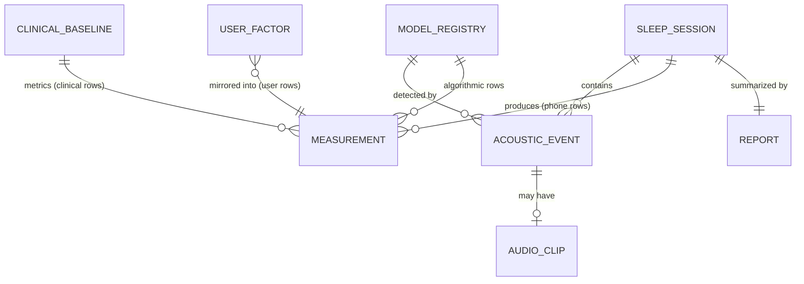

# Data Model — SleepAnalysis

Room/SQLite schema for the sleep intelligence platform. Design goals: **provenance on every measurement**, **immutable clinical data**, **long-lived analytics surviving heavy raw data**, and **no Tier-3 values ever stored** ([MEASUREMENT_RELIABILITY.md](MEASUREMENT_RELIABILITY.md)).

Related: [Architecture](ARCHITECTURE.md) (provenance enforcement, §6) · [MVP scope](MVP_SCOPE.md) · [Privacy & regulatory](PRIVACY_AND_REGULATORY.md)

---

## 1. Entity overview



`REPORT` (§3.7) and `MODEL_REGISTRY` (§3.8) are **planned tables**, not yet in the schema (reports are computed live; the active model is a version constant). Everything else is implemented.

Two write paths exist, both through `MeasurementRecorder` ([ARCHITECTURE.md](ARCHITECTURE.md) §6):

- **Session pipeline** (phone): AcousticEvent → Measurement → Report.
- **Entry/import paths**: clinical baseline (read-only form), user factors (form), wearable imports (Phase 3) — all landing as Measurement rows with their own source/method.

## 2. Conventions

- Timestamps: Unix epoch **milliseconds, UTC** (`Long`). Session-local times additionally stored as `offset_ms` from session start (timeline rendering across midnight/DST).
- Enums stored as `TEXT` (debuggability) with Room type converters.
- Booleans as `INTEGER`. Free-form structure as JSON `TEXT` with a `schema_version` alongside.
- All tables: `created_at` epoch ms; `updated_at` where mutable.

## 3. Core entities

### 3.1 `clinical_baseline` — one row per study night (immutable)

| Column | Type | Notes |
|---|---|---|
| `id` | Long PK | |
| `study_date` | TEXT (ISO-8601 date) | e.g. `2026-01-12` |
| `lab` | TEXT | `"HUG"` |
| `study_type` | TEXT | `"PSG"` |
| `night_label` | TEXT? | `"Night 1"`, user-entered |
| `total_sleep_time_minutes` | Int? | TST |
| `sleep_efficiency_percent` | Double? | |
| `arousal_index_per_hour` | Double? | Clinical arousal index (context — never compared to phone-derived anything) |
| `n3_percent` | Double? | |
| `ahi_per_hour` | Double? | Clinical AHI (context — M15 forbids a phone-derived counterpart) |
| `source_document` | TEXT? | Path/note pointing at the PDF report the numbers came from |
| `notes` | TEXT? | e.g. "hypopnea-dominant; technical artifacts noted" |
| `entered_at` | Long | When the user typed it in |

Phase 1 data (from the four HUG nights): TST 5h34m–7h35m; efficiency 70–91%; arousal index 27.0–31.9/h; N3 7–15%; AHI 17.6 (Night 1, predominantly hypopneas).

### 3.2 `measurement` — the universal, provenance-stamped metric table

One row per metric value. This is the table all longitudinal analysis (Phase 4+) reads.

| Column | Type | Notes |
|---|---|---|
| `id` | Long PK | |
| `session_id` | Long? FK → sleep_session, **ON DELETE SET NULL** | Null for clinical/user/period rows; survives session deletion |
| `baseline_id` | Long? FK → clinical_baseline | *Planned, not in the implemented table* — clinical values live in `clinical_baseline` (§3.1); mirroring into `measurement` is a Phase 4+ option |
| `source_type` | TEXT enum | `CLINICAL` / `PHONE` / `USER` / `GARMIN` (implemented) · `WEARABLE` reserved for Health Connect |
| `method` | TEXT enum | `CLINICAL_MEASURED` / `ALGORITHM_ESTIMATED` / `DEVICE_REPORTED` / `USER_REPORTED` |
| `measurement_type` | TEXT enum | See §3.3 |
| `tier` | TEXT enum | `ESTABLISHED` / `EXPERIMENTAL` — validated against `ClaimPolicy` at write time; Tier 3 types are rejected |
| `value_num` | REAL? | Numeric value |
| `value_text` | TEXT? | Non-numeric values |
| `unit` | TEXT enum | `SECONDS` / `MINUTES` / `PERCENT` / `COUNT` / `PER_HOUR` / `DBFS` / `INDEX_0_100` / `INDEX_0_10` / `MS` / `BPM` / `BREATHS_PER_MINUTE` |
| `is_clinical` | Bool | True only for clinical-source rows — SQL triggers + recorder logic key on it |
| `confidence` | REAL? | 0–1, nullable (user/clinical rows typically null) |
| `model_version` | TEXT? | Model identity stamped at write time — currently the `energy-heuristic-v1-spectral` constant (`+dbg1` suffix when the debug enter-windows toggle was active). The FK to `model_registry` applies once the registry exists (§3.8, Phase 2) |
| `period_start` / `period_end` | Long? | For period-scoped rows (e.g., per-hour, weekly) |
| `notes` | TEXT? | |
| `timestamp` | Long | When the value occurred (event/measurement time — not row-write time) |
| `created_at` | Long | When the row was written |

**Indices (implemented):** `(measurement_type, period_start)`, `(session_id)`, `(source_type, method)`.

**Example rows (as written by the implemented code):**

| session_id | source | method | type | tier | value | unit | model |
|---|---|---|---|---|---|---|---|
| 401 | PHONE | ALGORITHM_ESTIMATED | SNORE_TIME | ESTABLISHED | 812 | SECONDS | energy-heuristic-v1-spectral |
| 401 | PHONE | ALGORITHM_ESTIMATED | SNORE_INTENSITY_PEAK | ESTABLISHED | -14.2 | DBFS | energy-heuristic-v1-spectral |
| 401 | PHONE | ALGORITHM_ESTIMATED | NOISE_MEDIAN | ESTABLISHED | -31.5 | DBFS | energy-heuristic-v1-spectral |
| 401 | GARMIN | DEVICE_REPORTED | VENDOR_HRV_RMSSD | ESTABLISHED | 48 | MS | null |
| null | USER | USER_REPORTED | ALCOHOL_UNITS | ESTABLISHED | 2 | COUNT | null |

Clinical baseline values (e.g., AHI 17.6) currently live in `clinical_baseline` (§3.1) with their own provenance columns — they are **not** mirrored into `measurement` today.

### 3.3 `measurement_type` registry (extensible enum, enforced in `ClaimPolicy`)

**Phase 1 (Tier 1, phone):** `TIME_IN_BED`, `SNORE_EVENT_COUNT`, `SNORE_TIME`, `SNORE_SHARE_OF_NIGHT`, `SNORE_INTENSITY_PEAK`, `SNORE_INTENSITY_MEAN`, `SNORE_SCORE`, `ACOUSTIC_EVENT_COUNT` (per type), `NOISE_MEDIAN`, `NOISE_P95`.

**Phase 2+:** `SLEEP_DURATION_ESTIMATE`, `WAKE_DURATION_ESTIMATE`, `MOVEMENT_INDEX`, `BREATHING_IRREGULARITY_INDICATOR` (*Tier 2 — experimental*), `RESPIRATORY_PATTERN_INDICATOR` (*Tier 2 — experimental*).

**Clinical:** `TST`, `SLEEP_EFFICIENCY`, `AROUSAL_INDEX`, `N3_PERCENT`, `AHI`, plus free-text hypnogram summary via `notes`/`value_text`.

**Wearable (Phase 3, Garmin slice implemented — all `ESTABLISHED` device-reported pass-through, tiers per [MEASUREMENT_RELIABILITY.md](MEASUREMENT_RELIABILITY.md) §8):** `VENDOR_SLEEP_DURATION`, `VENDOR_SLEEP_SCORE`, `VENDOR_HRV_RMSSD`, `VENDOR_BODY_BATTERY`, `VENDOR_RESTING_HEART_RATE`, stage totals as four per-stage types (`VENDOR_DEEP_SLEEP` / `VENDOR_LIGHT_SLEEP` / `VENDOR_REM_SLEEP` / `VENDOR_AWAKE_SLEEP`; there is no `VENDOR_SLEEP_STAGES` row type), overnight heart rate (`VENDOR_AVG_HEART_RATE_SLEEP`), respiration (`VENDOR_RESPIRATION_AVG_SLEEP`), stress composites (`VENDOR_SLEEP_STRESS_AVG`, `VENDOR_STRESS_DAILY_AVG`), SpO₂ levels (`VENDOR_SPO2_AVG_SLEEP`, `VENDOR_SPO2_LOWEST_SLEEP`), `VENDOR_SLEEP_AWAKENINGS`, `VENDOR_NAP_TIME`, `VENDOR_SLEEP_NEED`, and the four sleep-score factor sub-scores (`VENDOR_SLEEP_FACTOR_{DURATION,QUALITY,STRESS,TIMING}`). `WEARABLE`-source rows arrive with the Health Connect slice.

**User:** factor keys (§3.6).

### 3.4 `sleep_session`

| Column | Type | Notes |
|---|---|---|
| `id` | Long PK | |
| `started_at` / `ended_at` | Long, `ended_at` nullable | Null ended_at ⇒ in progress / interrupted |
| `status` | TEXT enum | `COMPLETED` / `INTERRUPTED` / `RECOVERED` |
| `time_zone` | TEXT | IANA id at session start |
| `device_model`, `os_version`, `app_version` | TEXT | Reproducibility |
| `capture_stats` | TEXT (JSON, v2) | See §5.1 |
| `audio_bytes_total` | Long | Clip bytes written |
| `morning_notes` | TEXT (schema v6) | Short user note added after the night. User-entered context, never a measurement; **included in exports** |
| `resumed_after_interruption` | Bool (schema v7) | Set when START_STICKY resumed an open session after mid-night process death: capture was **not** continuous. The morning report leads its integrity notes with it. `RECOVERED` status covers the opposite outcome (death with no resume) |

### 3.5 `acoustic_event` and `audio_clip`

`acoustic_event` — raw detections (session-scoped, cascade-deleted):

| Column | Type | Notes |
|---|---|---|
| `id` | Long PK | |
| `session_id` | Long FK, **ON DELETE CASCADE** | |
| `type` | TEXT enum | Phase 1: `SNORE` / `COUGH` / `SPEECH` / `LOUD_BREATHING` / `OTHER_NOISE` / `UNKNOWN`. Phase 2 adds experimental types (`GASP_LIKE`, `BREATHING_PAUSE_CANDIDATE`) — Tier 2 only |
| `start_ms`, `end_ms` | Long | Epoch |
| `offset_ms`, `duration_ms` | Long | Session-local, derived-but-stored for queries |
| `peak_dbfs`, `mean_dbfs` | REAL | Relative intensity only ([MEASUREMENT_RELIABILITY.md](MEASUREMENT_RELIABILITY.md) M2) |
| `intensity_tier` | TEXT enum | `QUIET` / `LIGHT` / `LOUD` / `EPIC` |
| `confidence` | REAL | Model probability at peak |
| `model_version` | TEXT | Detector identity (e.g. `energy-heuristic-v1-spectral`); no model_id/registry FK yet (§3.8) |
| `clip_id` | Long? FK → audio_clip | |
| `user_label` | TEXT? | User-corrected class from clip playback: `SNORE` / `COUGH` / `SPEECH` / `MOVEMENT` / `OTHER_NOT_SNORE` — the personal labeled dataset Phase 2 model improvement trains against; never alters scores |
| `labeled_at` | Long? | When the user applied the label (schema v4) — distinguishes label age when curating training data |
| `features_json` | TEXT? | The detection model's decision inputs as JSON (schema v5; for `energy-heuristic-v1-spectral`: `enter_windows`, `exit_windows`, `open_windows`, `close_windows`, `snr_peak_db`, `snr_mean_db`, `low_band_ratio_peak`, `low_band_ratio_mean`, `noise_floor_dbfs` — the v0 rows predate `exit/open/close_windows` (added schema v7 era, 2026-11-02)). Debug visibility of detector decisions — never a measurement, never rendered as clinical |

`audio_clip`:

| Column | Type | Notes |
|---|---|---|
| `id` | Long PK | |
| `session_id` | Long FK, CASCADE | Denormalized for fast retention sweeps |
| `event_id` | Long? FK, unique | 1:1 with an event when set |
| `file_path` | TEXT | Relative to `filesDir/clips/` |
| `duration_ms`, `size_bytes`, `sample_rate` | Long/Int | sample_rate = 16000 |
| `created_at` | Long | |

**Index:** `(session_id, start_ms)` on events; `created_at` on clips (retention).

### 3.6 `user_factor` — lifestyle logging (implemented in Phase 3, lightweight UI)

| Column | Type | Notes |
|---|---|---|
| `id` | Long PK | |
| `date` | TEXT (ISO, local) | The day the factor applies to |
| `factor_key` | TEXT enum | `ALCOHOL` (units in valueNum, 1.0 = yes-unspecified), `LATE_MEAL`, `CAFFEINE_AFTER_14`, `EXERCISE`, `MEDICATION_OR_DEVICE` (1.0 = yes), `STRESS` (1–5), `NOTES` (valueText) |
| `value_num` / `value_text` | REAL? / TEXT? | |
| `recorded_at` | Long | |

Only set/affirmative factors are stored — absence means "not logged that day". Saving a date replaces that date's rows. These are **user-entered context, not measurements**: no tier, no confidence, no Measurement rows; the report renders them under "Daily factors (self-logged)". Mirroring into `measurement` (`source_type = USER`, `method = USER_REPORTED`) is deferred to Phase 4's analysis engine, which will read them with explicit user-reported framing. Wiped by delete-all.

### 3.7 `report` — morning report snapshot — **documented, not yet implemented**

Reports are currently **computed live in memory** (`ReportAssembler` → `MorningReport`) from events, measurements, and session context; they exist for the 90-day session retention window. This table is deferred to Phase 4 (reprocessing/trends) — the payload shape below (§5.2) is its target design.

| Column | Type | Notes |
|---|---|---|
| `id` | Long PK | |
| `session_id` | Long FK, CASCADE | |
| `schema_version` | Int | Payload version |
| `payload` | TEXT (JSON) | Assembled under `ClaimPolicy` — see §5.2 |
| `generated_at` | Long | |

Unique index `(session_id, schema_version)`; regeneration upserts. Reports never contain values ClaimPolicy would refuse to render.

### 3.8 `model_registry` — **documented, not yet implemented**

Planned per the table below, to land when a second model exists (Phase 2 model v1). Until then the active model identity is the constant `MODEL_VERSION = "energy-heuristic-v1-spectral"` in `SessionRepository`, stamped onto events and measurements.

| Column | Type | Notes |
|---|---|---|
| `id` | TEXT PK | e.g. `yamnet-mapped-v0`, `snorecnn-v1` |
| `asset_path`, `sha256` | TEXT | Bundled TFLite/ONNX file identity |
| `runtime` | TEXT enum | `TFLITE` / `ONNX` |
| `input_spec` | TEXT (JSON) | `{sample_rate: 16000, window_ms: 1000, hop_ms: 500, mel_bins: 64, frames: 96}` |
| `classes` | TEXT (JSON) | Ordered class list + label mapping |
| `thresholds` | TEXT (JSON) | Enter/exit/min-duration/merge defaults |
| `tier_map` | TEXT (JSON) | Which emitted event types are Tier 1 vs Tier 2 |
| `active` | INTEGER | Exactly one active |
| `created_at` | Long | |

### 3.9 `raw_payload` — vendor JSON storage (schema v2)

One row per `(source, endpoint, date)` (unique index), storing external API responses verbatim so field mappings can be corrected without data loss. Written by the Garmin import ([GARMIN_INTEGRATION.md](GARMIN_INTEGRATION.md) §5); re-import upserts. No retention expiry yet (rows are small); deletion happens with delete-all.

## 4. Clinical immutability

1. **Insert-only API.** `BaselineRepository` exposes insert + read only; no update/delete methods exist for clinical rows (delete-all purge is the sole exception, via a dedicated maintenance path).
2. **Database triggers.** Two triggers guard the `clinical_baseline` table itself:
   `CREATE TRIGGER IF NOT EXISTS trg_clinical_baseline_no_update BEFORE UPDATE ON clinical_baseline BEGIN SELECT RAISE(ABORT, 'clinical baseline is immutable'); END;` and the matching `trg_clinical_baseline_no_delete` for `DELETE`. `AppDatabase` creates them on database create **and re-creates them on every open**; they are dropped only inside `purgeEverythingIncludingClinical()` — the single delete-all maintenance path — and recreated in its `finally` block. (Protection of clinical *measurements* is enforced in code — `MeasurementRecorder`/`ClaimPolicy` — not SQL.)
3. **UI rule.** Baseline entries render read-only with an "entered <date> from <source>" caption; corrections mean a **new, superseding entry** (new row, `notes` cross-reference), never an edit — preserving the audit trail.
4. **Provenance display.** Every clinical number shown anywhere cites study date + lab.

## 5. JSON payloads

### 5.1 `capture_stats` (session) — implemented shape

Written at session finalize and at every heartbeat (progress persistence for START_STICKY carry) by `SessionRepository` from `AudioEngine.NightStats`. For sessions finalized as RECOVERED the final write is skipped — heartbeat-saved stats (if any) are kept as-is, so the row carries the last live counters plus `saved_at_ms`; only when the engine died before any heartbeat does the row fall back to `{"schema_version":1}`. Parsed tolerantly by `domain/report/CaptureStats` — missing/malformed fields become null — and rendered in the report's "Session health" section, where `ReportAssembler` derives plain-language health warnings (suspected capture gaps when windows processed fall > 10 % below the 0.5 s-hop expectation, thermal throttling).

Snore share and score (measurements and report) use **captured analysis time** — `(windows_processed + windows_skipped) × 0.5 s`, cumulative across engine restarts — as their denominator, not tap-to-end time in bed: the latter counts the start delay, process-death gaps and pre-capture wall time as "night". A RECOVERED session with no events records no time-in-bed, share or score at all.

```json
{
  "schema_version": 2,
  "windows_processed": 56340,
  "windows_skipped": 12,
  "ambient_dbfs_median": -31.5,
  "ambient_dbfs_p95": -22.1,
  "clip_count": 47,
  "thermal_throttle_events": 1,
  "level_gate_skipped": 231,
  "saved_at_ms": 1793564621686,
  "capture_started_at": 1793747285656,
  "thermal_skipped_hops": [[1793564621686, 1793564624686, 3], [1793564629686, 1793564630686, 1]]
}
```

`saved_at_ms` stamps heartbeat writes (a RECOVERED finalize bounds the night by the last heartbeat) and `capture_started_at` records when audio capture actually began after the start delay — the health-warning gap check compares processed windows against that capture window, not tap-to-stop wall time. v2 adds `level_gate_skipped` (events the relative level gate rejected — kept for diagnostics, the events are still stored without clips) and `thermal_skipped_hops`: merged spans of `[start_epoch_ms, end_epoch_ms, hops]` recording which analysis hops thermal throttling skipped (within a span, every odd hop of the 0.5 s grid was unanalyzed), so per-hour detection coverage can be corrected in analysis. Spans are epoch-anchored and concatenated across START_STICKY restarts via the stats carry.

### 5.2 Report `payload` (v1 — target shape for the deferred §3.7 snapshot)

```json
{
  "schema_version": 1,
  "session_id": 401,
  "headline": {
    "time_in_bed": {"seconds": 28920, "method": "ALGORITHM_ESTIMATED", "tier": "ESTABLISHED"},
    "snore_score": {"value": 34, "unit": "INDEX_0_100", "tier": "ESTABLISHED"},
    "snore_time": {"seconds": 812, "tier": "ESTABLISHED"}
  },
  "snoring": {"event_count": 214, "share_of_night": 0.028, "tiers": {"QUIET": 91, "LIGHT": 78, "LOUD": 39, "EPIC": 6}},
  "acoustic_events": {"COUGH": 0, "SPEECH": 3, "LOUD_BREATHING": 41, "OTHER_NOISE": 12},
  "hourly": [{"hour_start": "23:00", "snore_minutes": 6.2, "noise_p95_dbfs": -31.5}],
  "top_clips": [{"event_id": 9182, "offset_ms": 9460000, "intensity_tier": "EPIC"}],
  "integrity_notes": ["Interrupted 03:12–03:40 (audio device change)"],
  "baseline_context": [{"study_date": "2026-01-12", "metric": "AHI", "value": 17.6, "method": "CLINICAL_MEASURED"}],
  "disclaimer_key": "REPORT_FOOTER"
}
```

Every value carries (or inherits) `method` and `tier`; `ClaimPolicy` filtered what was allowed in.

### 5.3 Night ↔ calendar-day anchoring

Two different calendar days attach to one session, deliberately distinct:

- **Wake date — the Garmin join key.** Garmin keys a night's payload by its `calendarDate`, which is the morning the night *ends*: a session starting 21:52 on day D and ending 07:10 on day D+1 is Garmin's "day D+1" sleep entry. Every Garmin query (`SessionRepository` report join) and every session-triggered import (`ReportViewModel.importGarminForThisNight`) anchors on the local wake date — `endedAt` in the session timezone, or `startedAt + 12 h` for open sessions (`domain/report/NightDates`).
- **Start date — the self-logged factor key.** User-logged lifestyle factors are context about the evening the night began; they key on the day the session started (`NightDates.factorDay`).

Manual imports from Settings import the user-picked date as-is, so a manual import for an overnight session must target the wake date to be visible in that night's report.

## 6. Retention and deletion rules

| Data | Default retention | Rationale |
|---|---|---|
| Audio clips | **7 days** | Verification value fades; storage and privacy cost stay |
| Sessions + acoustic events | **90 days** | Full auditability window |
| Per-session log files (`filesDir/logs/session_<id>.log`) | With their session (worker purges past session retention) | Text diagnostics only — never audio |
| Measurements | **Indefinite** (survive session deletion via `SET NULL`) | Tiny rows; the longitudinal substrate; user can delete manually |
| Clinical baseline | **Until delete-all** | Never expires; the anchor of the platform |
| Reports | With their session | Regenerable while source data exists |

Deletion paths:

- **Per-night delete:** deletes report → events → clips → session (cascades); measurements of that session get `session_id = null` and persist.
- **Clips-only purge:** retention worker sweeps `audio_clip` rows past 7 days + files; events keep their metadata (clip_id becomes dangling-but-typed: cleared to null).
- **Delete-all:** single button, wipes DB (including clinical baseline) and clip files, with confirmation that includes "this removes your clinical baseline too". Trigger-based immutability is bypassed only here.
- **Orphan sweep:** daily job removes files under `filesDir/clips/` with no clip row.

## 7. Migrations and versioning

- Room schemas exported to `app/schemas/`; **shipped migrations are never edited**, only appended. Migration SQL is hand-reviewed and covered end-to-end by the instrumented `MigrationTest` (androidTest): seeds rows at v1, migrates to the latest version with `MigrationTestHelper`, verifies the rows survive and the clinical-immutability triggers exist and enforce.
- JSON payloads (`capture_stats`, report payload) carry `schema_version`; readers handle older versions defensively.
- `measurement_type`/enum growth is additive; `ClaimPolicy` is the gate, so unknown types in the DB can never render in the UI.
- Schema history: 1→8 via seven real migrations; v8 is declaration-only (`@ColumnInfo(defaultValue = "0")` on `sleep_session.resumedAfterInterruption`, matching the `DEFAULT 0` the column has carried since v7).
- Reprocessing (Phase 4+): re-running a newer model over stored clips writes **new** Measurement rows with the new `model_id`; old rows remain — provenance history is append-only.
